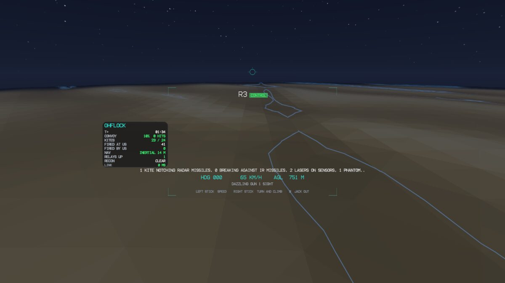

# glyder: Gygax in VR

glyder puts a running Gygax world in a VR headset. A simulation, or the real machines connected to a node, lies on a
map table in front of you. Point at a node and you drop into it at full scale; fly or drive it, then jack out and its
autonomy takes over again.



It has three parts:

| Part | What it is | Where |
| --- | --- | --- |
| Core | The experience (lobby, map table, ride, HUD, menus, vision correction), the wire protocol, the host and client, shared handling, the model kit and a demo world. Plain C++ and POSIX sockets; no GPU needed. Built and tested with Gygax by default (`GYGAX_BUILD_GLYDER`). | `glyder/include/glyder`, `glyder/src/core`, `glyder/tests` |
| Renderer | Vulkan: both eyes in one multiview pass, 4x MSAA resolved on tile, reversed-Z. | `glyder/src/render`, `glyder/shaders` |
| Platforms | Meta Quest (OpenXR in a NativeActivity, no Java, no engine), a desktop window, and headless capture. | `glyder/platform` |

## Hosts

A host is anything that publishes a world. Each of these listens on UDP 1999 (or the port you give) and prints its
pairing code:

```bash
./build/ohflock --glyder              # the flock over the dunes; take any kite
./build/wargames --glyder             # the last bunker; take any tank or drone (paces the battle to 0.5 s a tick)
./build/gygax serve --glyder \
    --device uav=mavlink:udp://0.0.0.0:14550 --glyder-origin 51.4779,-0.0015
```

`gygax serve --glyder` shows the machines registered with the node (`--device ID=KIND:URI`, repeatable, or added
later through the API) on a map centred on `--glyder-origin`, or on the first machine's position. A headset can
watch them, but it drives them only when the node runs with `--device-commands`: a pilot's sticks go through the same
`devices.command` gate as the REST API. Without it, the host says "viewing only".

Options shared by every host:

| Option | Meaning |
| --- | --- |
| `--glyder [PORT]` | publish to headsets (default port 1999) |
| `--glyder-code CODE` | the pairing code (default: a new six-digit code each run) |
| `--glyder-open` | no pairing code: for a private, trusted network only |

Your own simulation can be a host too: embed `glyder::Host`, call `publish()` with the world each step and
`service()` with a `glyder::Pilot` that answers drop-in requests. `glyder/include/glyder/host.hpp` shows the loop;
`examples/ohflock/vr.cpp` and `examples/wargames/vr.cpp` are complete examples.

## Network

The headset and the host must be on the same LAN. The headset finds hosts by broadcasting to UDP 1999 once a second,
so the host's firewall must accept UDP on that port from the LAN, for example:

```bash
sudo ufw allow from 192.168.1.0/24 to any port 1999 proto udp
```

USB is not enough: ADB forwards only TCP, and glyder is UDP throughout. On a network that blocks broadcast, the
desktop viewer takes `--host ADDRESS`; the Quest app relies on broadcast.

## The Quest app

Build it from `glyder/` with the Android NDK and SDK (build-tools and `platforms/android-34`):

```bash
cd glyder
export ANDROID_NDK_HOME=~/Android/Sdk/ndk/<version> ANDROID_HOME=~/Android/Sdk
cmake --preset quest && cmake --build --preset quest
adb install -r ../build/glyder-quest/glyder-<version>-quest.apk
```

There is no Gradle: CMake compiles the native library, downloads the Khronos OpenXR loader (Apache-2.0, pinned by
SHA-256), and packages, aligns and signs the APK with `aapt2`, `zipalign` and `apksigner`. The first build makes a
debug keystore in the build directory; set `GLYDER_KEYSTORE` to sign with your own.

Installing needs the headset in developer mode: in the Meta Horizon phone app, Devices → your headset → Headset
settings → Developer mode (your Meta account must belong to a developer organisation at developers.meta.com). Restart
the headset, connect USB and accept "Allow USB debugging". glyder then appears under Unknown sources in the app
library.

## Using it

**Lobby.** The Construct, a white void, lists the Gygax hosts on the network, each marked OPEN, PAIRING CODE or
PAIRED. Choose one and type its code; glyder remembers it. THE CONSTRUCT starts a small built-in world (a rover, a
quadcopter, a kite and a truck) so a headset is useful with no host at all.

**Map table.** Grip with one hand to drag and turn the table; grip with both to scale it. Point at a node to see what
it is (REAL MACHINE in gold when it is one) and pull the trigger to drop in.

**Ride.** The view switches at once. The node finishes what it is doing and hands over at its next stopping point;
until then the HUD says HANDOVER AT THE NEXT STOPPING POINT. Then YOU HAVE CONTROL: left stick for speed, right stick
to turn and climb. Host and headset run the same handling code, so your input shows at once and the host agrees with
it to within network jitter. Press **B** to jack out, instantly; autonomy resumes.

**Menu** (Y on the left controller, Tab on a desktop): horizon lock, comfort vignette, vision, and leave the host.

## Vision correction

Open VISION from the lobby or the menu and enter a spectacle prescription as written:

```
OD -1.25 -0.50 x 180 1.0 BI      OS: SPH -1.00 CYL -0.75 AXIS 90 PRISM 0.5 BU
PD 63    ADD +2.00    AGE 52
```

| Part | What glyder does | How well |
| --- | --- | --- |
| PD | places the virtual cameras at your pupillary distance | exact |
| Prism | turns each eye's view by its prism | exact |
| Sphere, cylinder | sharpens the image along the blur your eye adds at the headset's focal distance (about 1.3 m on a Quest 3S) | partial: restores contrast for mild prescriptions, roughly within ±1.5 D |

Beyond about ±1.5 D, wear your glasses with the headset's spacer or use lens inserts; glyder says so. Typing on a
controller is slow, so while the vision panel is open the headset serves a small page on port 1998: open the address
it shows on your phone and enter the PIN it shows. The page answers only to that PIN and only while the panel is
open, and the prescription never leaves the headset.

## Desktop viewer

The same experience in a window, with the mouse and keyboard standing in for the controllers. It needs Vulkan and
X11:

```bash
cd glyder && cmake --preset desktop && cmake --build --preset desktop
../build/glyder-desktop/glyder --demo
../build/glyder-desktop/glyder --connect 192.168.1.20 --code 482913
```

Point and click for the trigger; right-drag turns the table or looks around; the wheel zooms. WASD is the left stick,
the arrows the right, Space is A, Esc or Backspace is B, Tab opens the menu. `--stereo` draws both eyes side by side.

Headless, it renders offscreen and saves PNGs, which is how the frames on the project page were made:

```bash
glyder --connect 127.0.0.1 --capture ride.png --seconds 14 --script "4 drop 3"
```

`--script` takes timed cues: `drop ID|SHAPE`, `out`, `head X Y Z YAW PITCH`, `point X Y`, `click`, `menu`,
`stick H X Y`.

## Protocol

UDP on a LAN, latency first:

* **World state** goes out as self-contained snapshots, 34 bytes per entity with velocity, so a lost packet costs
  nothing and the client interpolates or extrapolates; the newest packet wins.
* **Head motion** never waits on the network: it is rendered from the headset's own tracking.
* **Controls** go up unreliably at the display rate, newest wins.
* **The few things that must arrive** (drop-in requests and grants, orders, narrative events, terrain) use a small
  acknowledged channel with in-order delivery.
* **Authentication:** after the handshake every packet carries an 8-byte HMAC-SHA-256 tag under a session key derived
  from the pairing secret and both sides' nonces, so nobody else on the LAN can drive a node or forge a grant.
* Packets are at most 1200 bytes, so they are never fragmented. Integers are little-endian; positions are metres in
  the host's east-north-up frame.

The definitions are in `glyder/include/glyder/wire.hpp`.

## Limits

* The Quest app finds hosts only by broadcast.
* glyder is a viewer and a remote control. It adds no safety layer to a machine: keep the autopilot's failsafes,
  geofence and a physical emergency stop. `--glyder-open` removes the only thing keeping other people on the network
  from driving a node.
* No headset build is attached to releases; build the APK from source.
